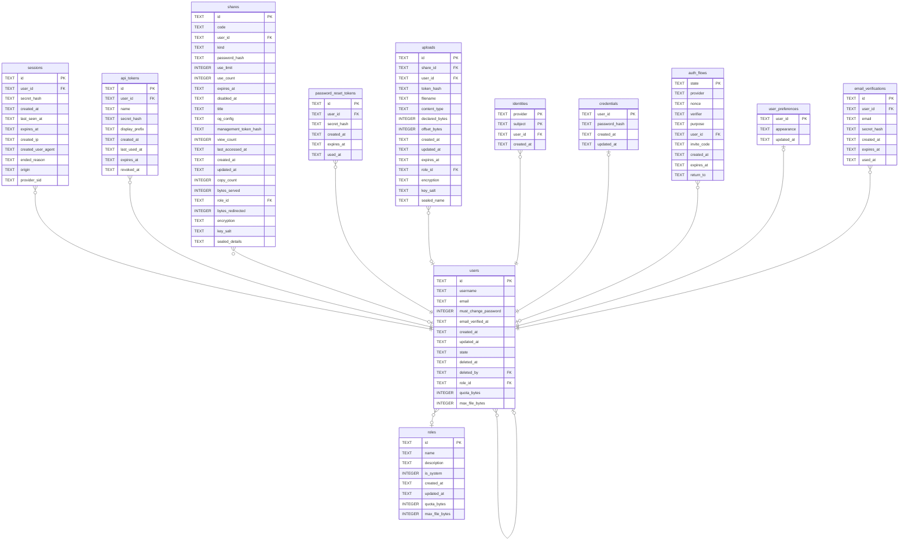

# users

## Description

Accounts. An empty `role_id` means signed in and allowed nothing, which is a real state rather than a fault. A deleted account leaves a scrubbed row behind rather than disappearing, because `shares.user_id` points at it and "nobody uploaded this" is a different fact from "whoever uploaded it is gone".

<details>
<summary><strong>Table Definition</strong></summary>

```sql
CREATE TABLE users (
    id            TEXT    NOT NULL PRIMARY KEY,
    username      TEXT    NOT NULL,
    email         TEXT    NOT NULL,
    must_change_password INTEGER NOT NULL DEFAULT 0,
    -- TEXT, not INTEGER: sqlx encodes an `OffsetDateTime` as RFC 3339 text for
    -- SQLite, and a column declared INTEGER would accept it anyway (SQLite types
    -- are advisory) while misrepresenting what is stored. Always UTC and always
    -- the same width, so lexicographic order matches chronological order.
    email_verified_at    TEXT,
    created_at    TEXT NOT NULL,
    updated_at    TEXT NOT NULL
, state TEXT NOT NULL DEFAULT 'active', deleted_at TEXT, deleted_by TEXT REFERENCES users (id) ON DELETE SET NULL, role_id TEXT REFERENCES roles (id) ON DELETE SET NULL, quota_bytes INTEGER, max_file_bytes INTEGER)
```

</details>

## Columns

| Name | Type | Default | Nullable | Children | Parents | Comment |
| ---- | ---- | ------- | -------- | -------- | ------- | ------- |
| id | TEXT |  | false | [users](users.md) [sessions](sessions.md) [api_tokens](api_tokens.md) [shares](shares.md) [password_reset_tokens](password_reset_tokens.md) [uploads](uploads.md) [identities](identities.md) [credentials](credentials.md) [auth_flows](auth_flows.md) [user_preferences](user_preferences.md) [email_verifications](email_verifications.md) |  |  |
| username | TEXT |  | false |  |  |  |
| email | TEXT |  | false |  |  |  |
| must_change_password | INTEGER | 0 | false |  |  |  |
| email_verified_at | TEXT |  | true |  |  |  |
| created_at | TEXT |  | false |  |  |  |
| updated_at | TEXT |  | false |  |  |  |
| state | TEXT | 'active' | false |  |  |  |
| deleted_at | TEXT |  | true |  |  |  |
| deleted_by | TEXT |  | true |  | [users](users.md) |  |
| role_id | TEXT |  | true |  | [roles](roles.md) |  |
| quota_bytes | INTEGER |  | true |  |  |  |
| max_file_bytes | INTEGER |  | true |  |  |  |

## Constraints

| Name | Type | Definition |
| ---- | ---- | ---------- |
| id | PRIMARY KEY | PRIMARY KEY (id) |
| - (Foreign key ID: 0) | FOREIGN KEY | FOREIGN KEY (role_id) REFERENCES roles (id) ON UPDATE NO ACTION ON DELETE SET NULL MATCH NONE |
| - (Foreign key ID: 1) | FOREIGN KEY | FOREIGN KEY (deleted_by) REFERENCES users (id) ON UPDATE NO ACTION ON DELETE SET NULL MATCH NONE |
| sqlite_autoindex_users_1 | PRIMARY KEY | PRIMARY KEY (id) |

## Indexes

| Name | Definition |
| ---- | ---------- |
| idx_users_role | CREATE INDEX idx_users_role ON users (role_id) |
| idx_users_state | CREATE INDEX idx_users_state ON users (state) |
| idx_users_email | CREATE UNIQUE INDEX idx_users_email ON users (email) |
| idx_users_username | CREATE UNIQUE INDEX idx_users_username ON users (username) |
| sqlite_autoindex_users_1 | PRIMARY KEY (id) |

## Relations



---

> Generated by [tbls](https://github.com/k1LoW/tbls)
