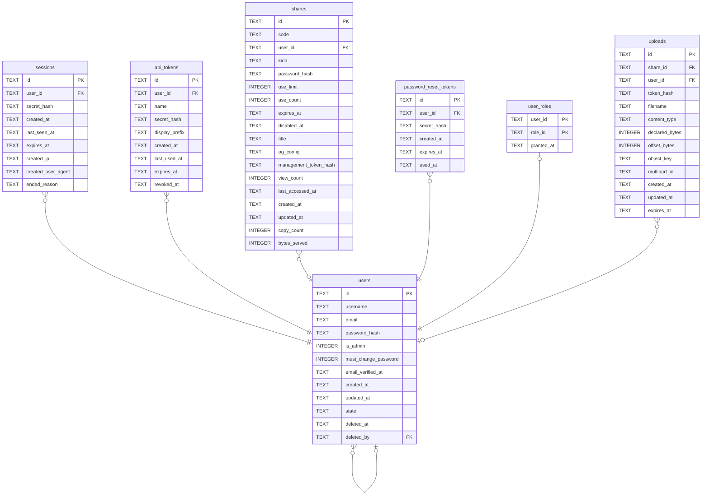

# users

## Description

帳號。刪掉的不會消失,只會變成一列洗乾淨的殘骸——因為 shares.user_id 指著它,而「沒有人上傳過」和「上傳的人不在了」是兩件不同的事。

<details>
<summary><strong>Table Definition</strong></summary>

```sql
CREATE TABLE users (
    id            TEXT    NOT NULL PRIMARY KEY,
    username      TEXT    NOT NULL,
    email         TEXT    NOT NULL,
    password_hash TEXT    NOT NULL,
    is_admin      INTEGER NOT NULL DEFAULT 0,
    -- Set when the account must change its password before doing anything else,
    -- which is how the generated first-run administrator is handed over safely.
    must_change_password INTEGER NOT NULL DEFAULT 0,
    -- TEXT rather than INTEGER: sqlx encodes an `OffsetDateTime` as RFC 3339
    -- text for SQLite, and a column declared INTEGER would take it anyway
    -- (SQLite types are advisory) while making every `psql`-equivalent session
    -- lie about what is stored. Always UTC and always the same width, so
    -- lexicographic ordering matches chronological ordering.
    email_verified_at    TEXT,
    created_at    TEXT NOT NULL,
    updated_at    TEXT NOT NULL
, state TEXT NOT NULL DEFAULT 'active', deleted_at TEXT, deleted_by TEXT REFERENCES users (id) ON DELETE SET NULL)
```

</details>

## Columns

| Name | Type | Default | Nullable | Children | Parents | Comment |
| ---- | ---- | ------- | -------- | -------- | ------- | ------- |
| id | TEXT |  | false | [users](users.md) [sessions](sessions.md) [api_tokens](api_tokens.md) [shares](shares.md) [password_reset_tokens](password_reset_tokens.md) [user_roles](user_roles.md) [uploads](uploads.md) |  |  |
| username | TEXT |  | false |  |  |  |
| email | TEXT |  | false |  |  |  |
| password_hash | TEXT |  | false |  |  |  |
| is_admin | INTEGER | 0 | false |  |  |  |
| must_change_password | INTEGER | 0 | false |  |  |  |
| email_verified_at | TEXT |  | true |  |  |  |
| created_at | TEXT |  | false |  |  |  |
| updated_at | TEXT |  | false |  |  |  |
| state | TEXT | 'active' | false |  |  |  |
| deleted_at | TEXT |  | true |  |  |  |
| deleted_by | TEXT |  | true |  | [users](users.md) |  |

## Constraints

| Name | Type | Definition |
| ---- | ---- | ---------- |
| id | PRIMARY KEY | PRIMARY KEY (id) |
| - (Foreign key ID: 0) | FOREIGN KEY | FOREIGN KEY (deleted_by) REFERENCES users (id) ON UPDATE NO ACTION ON DELETE SET NULL MATCH NONE |
| sqlite_autoindex_users_1 | PRIMARY KEY | PRIMARY KEY (id) |

## Indexes

| Name | Definition |
| ---- | ---------- |
| idx_users_state | CREATE INDEX idx_users_state ON users (state) |
| idx_users_email | CREATE UNIQUE INDEX idx_users_email ON users (email) |
| idx_users_username | CREATE UNIQUE INDEX idx_users_username ON users (username) |
| sqlite_autoindex_users_1 | PRIMARY KEY (id) |

## Relations



---

> Generated by [tbls](https://github.com/k1LoW/tbls)
