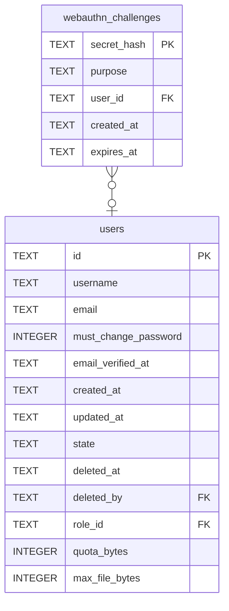

# webauthn_challenges

## Description

A challenge handed to a browser and not yet answered. Keyed on its digest and deleted when answered, so each works once. `purpose` keeps a sign-in challenge from registering a key, and `user_id` says whose account a registration adds to; a sign-in has none until the answer names one.

<details>
<summary><strong>Table Definition</strong></summary>

```sql
CREATE TABLE webauthn_challenges (
    secret_hash TEXT NOT NULL PRIMARY KEY,
    purpose     TEXT NOT NULL,
    user_id     TEXT REFERENCES users (id) ON DELETE CASCADE,
    created_at  TEXT NOT NULL,
    expires_at  TEXT NOT NULL
)
```

</details>

## Columns

| Name | Type | Default | Nullable | Children | Parents | Comment |
| ---- | ---- | ------- | -------- | -------- | ------- | ------- |
| secret_hash | TEXT |  | false |  |  |  |
| purpose | TEXT |  | false |  |  |  |
| user_id | TEXT |  | true |  | [users](users.md) |  |
| created_at | TEXT |  | false |  |  |  |
| expires_at | TEXT |  | false |  |  |  |

## Constraints

| Name | Type | Definition |
| ---- | ---- | ---------- |
| secret_hash | PRIMARY KEY | PRIMARY KEY (secret_hash) |
| - (Foreign key ID: 0) | FOREIGN KEY | FOREIGN KEY (user_id) REFERENCES users (id) ON UPDATE NO ACTION ON DELETE CASCADE MATCH NONE |
| sqlite_autoindex_webauthn_challenges_1 | PRIMARY KEY | PRIMARY KEY (secret_hash) |

## Indexes

| Name | Definition |
| ---- | ---------- |
| idx_webauthn_challenges_expires_at | CREATE INDEX idx_webauthn_challenges_expires_at ON webauthn_challenges (expires_at) |
| sqlite_autoindex_webauthn_challenges_1 | PRIMARY KEY (secret_hash) |

## Relations



---

> Generated by [tbls](https://github.com/k1LoW/tbls)
