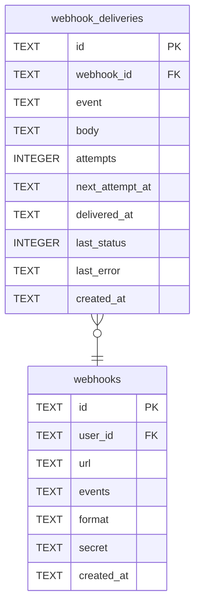

# webhook_deliveries

## Description

<details>
<summary><strong>Table Definition</strong></summary>

```sql
CREATE TABLE webhook_deliveries (
    id              TEXT    NOT NULL PRIMARY KEY,
    webhook_id      TEXT    NOT NULL REFERENCES webhooks (id) ON DELETE CASCADE,
    event           TEXT    NOT NULL,
    body            TEXT    NOT NULL,
    attempts        INTEGER NOT NULL DEFAULT 0,
    next_attempt_at TEXT,
    delivered_at    TEXT,
    -- The last answer: an HTTP status, or why there was none.
    last_status     INTEGER,
    last_error      TEXT,
    created_at      TEXT    NOT NULL
)
```

</details>

## Columns

| Name | Type | Default | Nullable | Children | Parents | Comment |
| ---- | ---- | ------- | -------- | -------- | ------- | ------- |
| id | TEXT |  | false |  |  |  |
| webhook_id | TEXT |  | false |  | [webhooks](webhooks.md) |  |
| event | TEXT |  | false |  |  |  |
| body | TEXT |  | false |  |  |  |
| attempts | INTEGER | 0 | false |  |  |  |
| next_attempt_at | TEXT |  | true |  |  |  |
| delivered_at | TEXT |  | true |  |  |  |
| last_status | INTEGER |  | true |  |  |  |
| last_error | TEXT |  | true |  |  |  |
| created_at | TEXT |  | false |  |  |  |

## Constraints

| Name | Type | Definition |
| ---- | ---- | ---------- |
| id | PRIMARY KEY | PRIMARY KEY (id) |
| - (Foreign key ID: 0) | FOREIGN KEY | FOREIGN KEY (webhook_id) REFERENCES webhooks (id) ON UPDATE NO ACTION ON DELETE CASCADE MATCH NONE |
| sqlite_autoindex_webhook_deliveries_1 | PRIMARY KEY | PRIMARY KEY (id) |

## Indexes

| Name | Definition |
| ---- | ---------- |
| idx_webhook_deliveries_webhook | CREATE INDEX idx_webhook_deliveries_webhook ON webhook_deliveries (webhook_id, created_at) |
| idx_webhook_deliveries_due | CREATE INDEX idx_webhook_deliveries_due ON webhook_deliveries (next_attempt_at) |
| sqlite_autoindex_webhook_deliveries_1 | PRIMARY KEY (id) |

## Relations



---

> Generated by [tbls](https://github.com/k1LoW/tbls)
