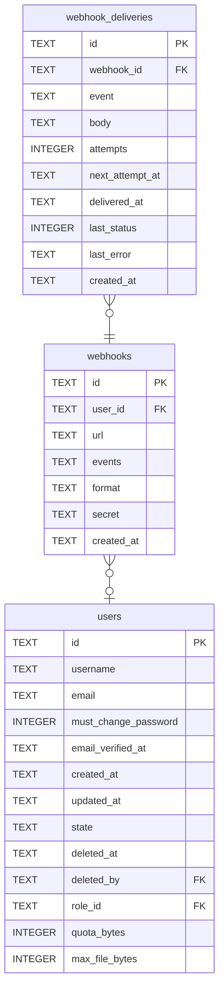

# webhooks

## Description

<details>
<summary><strong>Table Definition</strong></summary>

```sql
CREATE TABLE webhooks (
    id         TEXT NOT NULL PRIMARY KEY,
    user_id    TEXT REFERENCES users (id) ON DELETE CASCADE,
    url        TEXT NOT NULL,
    -- Space-separated, such as `share.created share.downloaded`.
    events     TEXT NOT NULL,
    -- `json`, or `discord` for a Discord channel's webhook.
    format     TEXT NOT NULL,
    secret     TEXT NOT NULL,
    created_at TEXT NOT NULL
)
```

</details>

## Columns

| Name | Type | Default | Nullable | Children | Parents | Comment |
| ---- | ---- | ------- | -------- | -------- | ------- | ------- |
| id | TEXT |  | false | [webhook_deliveries](webhook_deliveries.md) |  |  |
| user_id | TEXT |  | true |  | [users](users.md) |  |
| url | TEXT |  | false |  |  |  |
| events | TEXT |  | false |  |  |  |
| format | TEXT |  | false |  |  |  |
| secret | TEXT |  | false |  |  |  |
| created_at | TEXT |  | false |  |  |  |

## Constraints

| Name | Type | Definition |
| ---- | ---- | ---------- |
| id | PRIMARY KEY | PRIMARY KEY (id) |
| - (Foreign key ID: 0) | FOREIGN KEY | FOREIGN KEY (user_id) REFERENCES users (id) ON UPDATE NO ACTION ON DELETE CASCADE MATCH NONE |
| sqlite_autoindex_webhooks_1 | PRIMARY KEY | PRIMARY KEY (id) |

## Indexes

| Name | Definition |
| ---- | ---------- |
| idx_webhooks_user | CREATE INDEX idx_webhooks_user ON webhooks (user_id) |
| sqlite_autoindex_webhooks_1 | PRIMARY KEY (id) |

## Relations



---

> Generated by [tbls](https://github.com/k1LoW/tbls)
