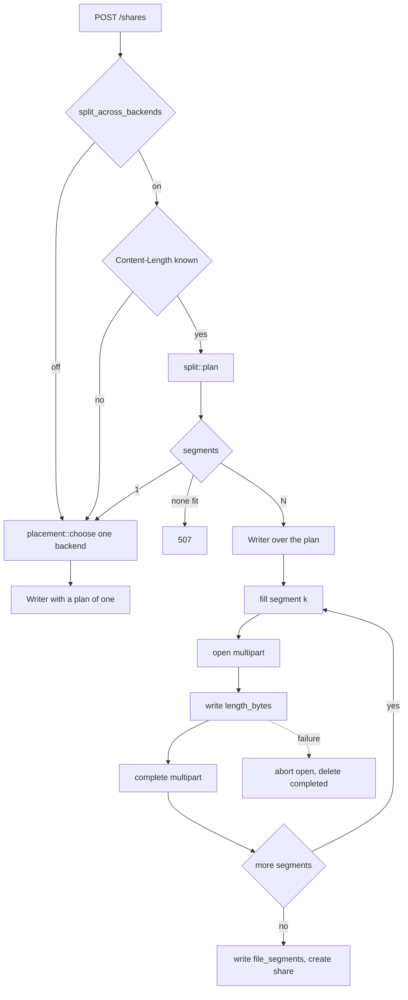
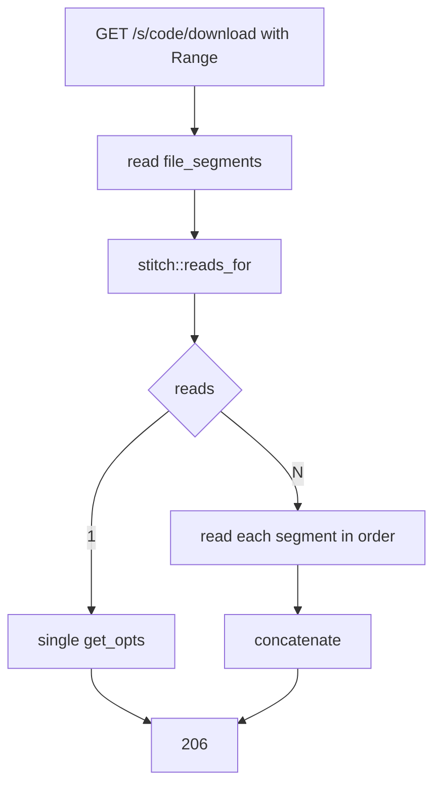

# Splitting a file across backends

A free Backblaze account holds 10 GB. Five of them hold 50 GB, but none of them holds a 15 GB file. Storing one means cutting it up.

Off by default. Turning on `storage.split_across_backends` lets a file larger than any single backend go up in pieces and come back whole.

Code: `storage/split.rs`, `storage/stitch.rs`, `storage/in_flight.rs`, `upload/segments.rs`. Those module docs carry the reasoning; this file carries the order things happen in.

## Where things are

| Piece                            | Where                               |
| -------------------------------- | ----------------------------------- |
| Planner                          | `storage::split::plan`              |
| Pool capacity                    | `storage::split::capacity`          |
| Range mapping                    | `storage::stitch::reads_for`        |
| Writing across segments          | `upload::segments::Writer`          |
| Reading across segments          | `api::public::stream_stitched`      |
| In-flight byte ledger            | `storage::in_flight`                |
| Tables                           | migrations `m20260903`, `m20260904` |
| Sweep                            | `maintenance::abandon`              |
| A store that fills up mid-upload | `tests/common/brimming.rs`          |
| The switch                       | `storage.split_across_backends`     |

## Upload

### Content-Length is required to split

A chunked body declares no size. The planner needs one to cut against, and discovering halfway through that the pool is too small leaves segments written across several backends with no way to finish.

Without a length the upload is placed whole on one backend, same as with the switch off.

### Where the reservation lives

The original design put `upload_segments` rows in state `planned` before any bytes arrived. That does not work for direct uploads, and the reason is structural: `POST /shares` has no `uploads` row, because there is nothing to record against until the share exists, and `upload_segments.upload_id` is a foreign key to one.

`storage::in_flight` holds the space instead. It counts bytes as they arrive and adds them to the database's figures, so two uploads planning against the same backend at the same moment see each other.

`planned` is still unwritten. It is the right shape for resumable uploads, which do have rows, and which do not split yet either.

### What does not split

- **Resumable (`tus`) uploads.** They go through `place_resumable`, which picks one backend. The session declares its size up front, so the planner would fit, but it needs `planned` rows and a writer that survives across requests.
- **Anything without a `Content-Length`.** Deliberate, see above.

## Download

The `ETag` is `"{share.id}-{size}"` and always has been. If it were any single store's `ETag`, a split file would advertise a tag describing one segment, and `If-Range` resume would fetch the wrong thing.

## Invariants

Each has a test. Each produces a corrupt download rather than an error when it breaks.

- **The plan tiles the file exactly.** No gaps, no overlaps, offsets ascending from zero. A gap loses bytes; an overlap writes them twice.
- **A segment takes everything its backend has free.** See below.
- **A backend below `min_segment` is skipped.** Taking 6 MB from a backend with 6 MB free costs a segment, a row, a multipart upload and another place for the reader to stall.
- **Reads answer exactly the range requested.** One byte short is a truncated download; one byte long is a corrupt one.
- **Cleanup walks every segment.** A session across two backends is two multipart uploads, and S3 bills for abandoned parts until someone aborts them.

### Segments are not part-aligned

Cuts used to round down to a whole `part_size`, on the belief that S3 required it. It does not. Each segment is its own multipart upload, so its last part may be short. The suite proves this on every CI store by storing 20 MiB in 8 MiB parts (8, 8, 4).

Rounding down made the remainder of every backend unreachable, so it was removed.

Resumable splitting will need it back: a `tus` chunk is already a whole number of parts, and aligned segments are what let a request end with nothing buffered.

## Costs

Worth knowing before turning it on.

- **No direct links.** A presigned URL names one object; a split file is several. Bytes come back through the server, or the browser stitches them.
- **Two multipart uploads instead of one.** More round trips, more to clean up, more ways to fail.
- **Bandwidth billed twice on some free tiers**, which meter upload and download separately.

## Not built

- **Browser-side stitching.** A split file currently streams through the server, which costs the bandwidth splitting was meant to save. Doing better needs per-segment presigned URLs, which needs the direct-download work, which has its own tradeoffs around download counting and password checks.
- **Resumable splitting.** See above.
