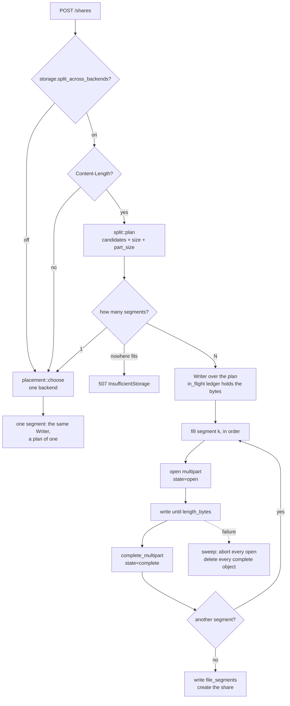
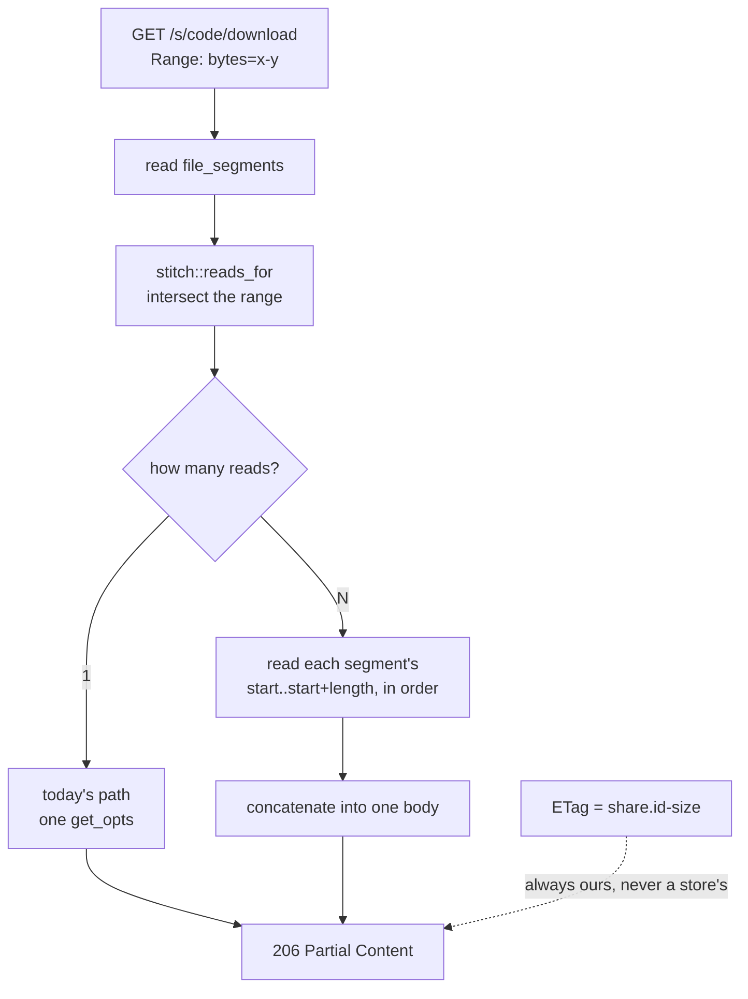

# Splitting a file across backends

One free Backblaze account holds 10 GB. Five of them hold 50 GB, and no single one of them holds a 15 GB file — so moving one takes cutting it up. That is [#184], and this is the shape of it.

The reasoning lives next to the code, in the module docs of `storage/split.rs`, `storage/stitch.rs` and `storage/in_flight.rs`. What is here is the part those cannot carry: `rustdoc` does not draw diagrams, and the order these pieces run in is the half that is easy to get wrong.

## What exists today

All of it, with the switch off by default. Turning
`storage.split_across_backends` on makes a file larger than any single backend
go up in pieces and come back whole — there is an end-to-end test that does
exactly that against two buckets neither of which could hold it.

What is *not* built is the frontend delivery in [#184]: a split file has no
direct link, so its bytes come back through the server rather than being
stitched in the browser.

| Piece | Where |
|---|---|
| Planner | `storage::split::plan` |
| Range mapping | `storage::stitch::reads_for` |
| Writing across segments | `upload::segments::Writer` |
| Reading across segments | `api::public::stream_stitched` |
| `upload_segments` / `file_segments` | migrations `m20260903`, `m20260904` |
| Sweep over every segment | `maintenance::abandon` |
| A store that stops mid-upload | `tests/common/brimming.rs` |
| The switch | `storage.split_across_backends` |

## Upload

### Why a `Content-Length` is required to split

A chunked body declares nothing. The planner needs a size to cut against, and finding out halfway that the pool is short leaves segments already written to several backends with no way to finish. Without a length the upload is placed whole, which is what happens today.

### Where the reservation actually lives

The design said `upload_segments` rows in state `planned`, written before any
bytes. The implementation does not, and the reason is structural rather than a
shortcut: a direct `POST /shares` has no `uploads` row at all — there is nothing
to record against until the share exists — and `upload_segments.upload_id` is a
foreign key to one. There is nowhere to put the row.

What holds the space instead is `storage::in_flight`, which counts bytes as they
arrive and is added to the database's figures. Two uploads planning against the
same backend at the same moment see each other through it.

`planned` is therefore still unwritten. It is the right shape for the resumable
path, which *does* have rows — and which does not split yet either. Both are the
same piece of work, and neither is done.

### What does not split yet

- **Resumable (`tus`) uploads.** They go through `place_resumable`, which picks
  one backend. A session declares its size up front, so the planner would fit
  well; what is missing is the `planned` rows above and a writer that survives
  across requests.
- **Anything without a `Content-Length`.** Deliberate, and above.

## Download

### Why the `ETag` was never a problem

`etag_for` has always been `"{share.id}-{size}"`, derived from our own identifiers. Had it been any single store's `ETag`, a split file would hand out a tag describing one segment and `If-Range` would resume against the wrong thing.

## Invariants worth restating

These are the ones with a test each, because each of them is a corrupt download rather than an error message when it breaks.

- **The plan tiles the file exactly.** No gap, no overlap, offsets ascending from zero. A gap loses bytes; an overlap writes them twice.
- **Every segment but the last is a whole number of parts.** S3 refuses a non-final part below 5 MiB, so an unaligned cut makes every following part straddle a boundary.
- **A backend below `min_segment` is not involved at all.** Taking 6 MB from a backend with 6 MB free costs a segment, a row, a multipart upload and a place for the reader to stall.
- **The reads answer exactly the range asked for.** One byte short is a truncated download, one byte long is a corrupt one.
- **Cleanup walks every segment.** A session over two backends is two multipart uploads, and S3 bills for an abandoned one's parts until somebody aborts it.

## What splitting costs

Worth knowing before turning it on, which is why it is off by default.

- **No direct links.** A presigned URL names one object; a split file is several. The download comes back through the server, or the browser stitches it — see [#184] for the measurements behind that choice.
- **Two multipart uploads, not one.** More round trips, more to clean up, more places to fail.
- **Bandwidth is billed twice on some free tiers**, which count upload and download separately. That is the operator's call, and the switch is how they make it.

[#184]: https://github.com/Limatura/tessera/issues/184
