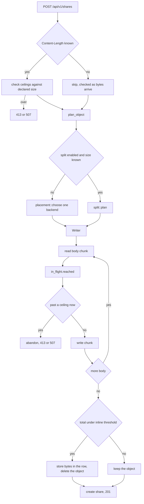

# Uploading

`POST /api/v1/shares` takes a body and turns it into a share. Between those two things: three quota ceilings, a choice of backend, a decision about whether the bytes go in the database or an object store, and a running count of bytes that no table knows about yet.

Code: `api/shares.rs`, `upload/sink.rs`, `upload/segments.rs`, `storage/placement.rs`, `storage/in_flight.rs`.

Resumable uploads are a separate path; see `resumable.md`. Splitting across backends is `splitting.md`.

## Where things are

| Piece | Where |
| --- | --- |
| The endpoint | `api::shares::create` |
| Reading the body | `api::shares::ingest` |
| Quota checks | `api::shares::enforce_ceiling`, `refuse_if_past` |
| Choosing a backend | `storage::placement::choose` |
| Bytes arriving right now | `storage::in_flight` |
| Writing across segments | `upload::segments::Writer` |
| Concurrent first write to a new prefix | `storage::first_write` |

## Flow

## Three ceilings

`Tier` in `error.rs` names them. All three are checked, and the tightest wins:

| Tier     | Setting                                                   |
| -------- | --------------------------------------------------------- |
| Account  | the user's own quota                                      |
| Role     | the quota on their role, or the guest role when anonymous |
| Instance | `storage.max_total_bytes`                                 |

Plus a per-backend ceiling: the backend's `capacity_bytes`.

### Checked twice, on purpose

Once before reading, when `Content-Length` says how big it will be. Again as bytes arrive, because a chunked body declares nothing and a declared length is a claim, not a fact.

The second check is what makes the first one safe to trust.

### The in-flight ledger

Both ceilings are read from the database once, before the body. Two uploads arriving together read the _same_ figure and both believe the whole remainder is theirs.

Measured before `storage::in_flight` existed: an instance capped at 50 KiB, two concurrent 40 KiB uploads, both answered `201`. Eighty kilobytes stored against a fifty kilobyte ceiling.

`in_flight` counts bytes as they land and adds them to the database's figures. Dropping the guard returns them, so a failed upload stops holding room the moment the handler returns.

It does not pick a winner. Two uploads crossing the line together both stop, thirty kilobytes each into fifty kilobytes of room, and neither finishes. That is deliberate: choosing a winner means reserving space up front, and the size to reserve is exactly what a chunked body will not say. Refusing both wastes bandwidth; letting both through leaves a bucket over quota, which on a free tier is not recoverable by retrying.

The database figures also go stale mid-upload if another upload finishes. `re_read_interval` re-reads them periodically, at a quarter of the remaining room, capped at one part size.

This is a single-process ledger. A second instance sharing a bucket does not see these bytes. That is the honest limit, and why the database figures stay the base rather than being replaced.

## Inline versus object store

Under `share.inline_threshold_bytes`, content lives in the database row. Above it, in an object store.

The threshold exists because a small paste in an object store means a round trip to serve a few hundred bytes, and an object to clean up later.

The decision is made _after_ the body is read, since a chunked upload does not know its size in advance. A small upload that went to the store is written back into the row and the object deleted.

## Choosing a backend

`storage::placement::choose` uses best-fit: the fullest backend that still has room.

`rclone` ships both policies. Spreading across the emptiest backend balances load and leaves every backend with a gap at the end. Filling the fullest one that still fits concentrates the leftover into one place.

The audience here is someone pooling free tiers, where the scarce thing is bytes rather than throughput. Gaps matter; balance does not.

`choose` never splits a file. If nothing has room for the whole thing, that is a refusal. `storage::split` is the other answer.

### Backends that cannot take a streamed upload

A file past the inline threshold is written with `put_multipart` while it is still arriving. The HTTP/WebDAV store does not implement it, because WebDAV's only upload verb is a whole-body `PUT`. So the placer skips those backends for large files and answers `413` rather than failing at the write.

## First write into a fresh prefix

Object stores have no directories, so for most backends this is nothing. WebDAV does have them, and does not create them on `PUT`: the write answers `409`, and `object_store` walks up with MKCOL and retries once.

Several uploads arriving together into a fresh backend each hit the `409`, each start creating `shares/YYYY/MM`, and the one whose single retry lands while a sibling's MKCOL is still in flight has nothing left to try.

Measured against `rclone serve webdav`: a four-test suite run in parallel was reliably flaky. `storage::first_write` serialises the first write to a prefix and remembers which prefixes exist.

## Tested invariants

| Rule | Test |
| --- | --- |
| Two concurrent uploads cannot both spend the last of the room | `two_uploads_at_once_cannot_both_spend_the_last_of_the_room` |
| An in-flight upload counts against its backend | `an_upload_in_flight_counts_against_its_backend` |
| One account's usage is not another's | `one_accounts_usage_does_not_spend_anothers` |
| A backend that cannot stream is not offered a large file | see `object_store` suite |

The concurrency ones are nets rather than proofs. Whether two bodies interleave usefully is the scheduler's business, so they run several rounds. The deterministic guarantees are `storage::in_flight`'s own unit tests.
